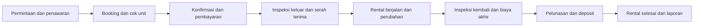

# TravelOS Product Requirements Document

**Versi:** 1.0  
**Tanggal:** 1 November 2026

## 01  Tujuan dan cakupan produk

TravelOS membantu pemilik dan tim rental kendaraan menjalankan penyewaan dari permintaan pelanggan hingga pengembalian kendaraan dan penyelesaian keuangan. Dokumen ini menjadi acuan desain, pengembangan, pengujian, dan peluncuran aplikasi.

### Arah produk

Pertahankan pola tampilan prototipe yang sudah disukai: dashboard, navigasi modul, tabel dengan filter, serta panel samping untuk tambah, edit, dan detail singkat. Lengkapi alur dan data agar semua modul bekerja sebagai satu aplikasi operasional.

### Masalah yang diselesaikan

- Jadwal kendaraan berisiko bentrok ketika booking, perpanjangan, dan maintenance tidak saling terhubung.
- Tim perlu melacak kesiapan kendaraan, kondisi serah terima, tagihan, dan jaminan dalam satu tempat.
- Owner membutuhkan angka usaha yang konsisten serta riwayat keputusan dan perubahan transaksi.

### Cakupan rilis

| Rilis | Cakupan |
| --- | --- |
| R1 untuk live | 20 modul inti pada halaman 2; seluruh alur rental internal, dokumen, keuangan, dan kontrol akses. |
| R2 lanjutan | Booking publik, portal pelanggan/rekanan, sopir, pengantaran, transfer unit, GPS, dan integrasi otomatis. |

Status dokumen: acuan perencanaan untuk ditinjau. Usulan improvement masuk dalam cakupan rancangan; aturan yang belum disepakati tercantum pada halaman 12. Tidak ada komitmen jadwal atau pilihan teknologi final dalam dokumen ini.

### Target keberhasilan yang diusulkan

- Seluruh booking aktif memiliki pelanggan, unit, periode, dan status pembayaran yang dapat ditelusuri.
- Tidak ada dua booking terkonfirmasi pada kendaraan yang sama untuk waktu yang bertumpang tindih.
- Seluruh kendaraan keluar dan kembali melalui bukti inspeksi serta pencatatan petugas.
- Tagihan, pembayaran, deposit, dan laporan dapat direkonsiliasi tanpa menghitung deposit sebagai pendapatan.

## 02  Pengguna dan peta halaman

| Peran | Tanggung jawab dan batas akses |
| --- | --- |
| Owner | Seluruh cabang yang diizinkan, laporan, pengaturan, persetujuan pengecualian dan transaksi sensitif. |
| Admin rental | Pelanggan, booking, kalender, dokumen dan koordinasi kendaraan; tidak mengubah hak akses. |
| Keuangan | Invoice, pembayaran, pengeluaran, deposit, refund dan pembayaran rekanan; tidak mengelola pengguna. |
| Petugas lapangan | Tugas yang ditugaskan, inspeksi, foto, BBM, kilometer dan maintenance; tanpa laporan keuangan menyeluruh. |

Izin diterapkan di server, termasuk batas cabang dan akses dokumen. Pengguna dapat memiliki lebih dari satu peran sesuai konfigurasi owner.

| Modul inti | Halaman dan lokasi fitur |
| --- | --- |
| 01 Akses akun | Login, lupa/reset password, akun saya |
| 02 Dashboard | Ringkasan dan tugas hari ini |
| 03 Booking dan penawaran | Daftar serta detail booking; form tambah/edit |
| 04 Perubahan rental | Perpanjangan, reschedule, ganti unit, pembatalan di detail booking |
| 05 Kalender | Jadwal hari, minggu, bulan dan konflik |
| 06 Armada | Daftar dan detail kendaraan; tarif dan dokumen |
| 07 Pelanggan | Daftar dan detail individu/perusahaan |
| 08 Inspeksi | Daftar, form mobile dan detail serah terima |
| 09 Kerusakan | Tab kerusakan pada detail inspeksi |
| 10 Maintenance | Daftar, form, detail pekerjaan dan penyelesaian |
| 11 Invoice dan dokumen | Daftar/detail invoice; dokumen pada booking |
| 12 Pembayaran | Daftar/detail transaksi pembayaran |
| 13 Deposit dan refund | Saldo, potongan dan pengembalian |
| 14 Pengeluaran | Daftar/form/detail pengeluaran |
| 15 Rekanan | Daftar/detail mitra dan perhitungan kewajiban |
| 16 Laporan | Laporan operasional dan keuangan |
| 17 Notifikasi | Dropdown dan pusat notifikasi |
| 18 Komunikasi | Riwayat pada booking/pelanggan; template di pengaturan |
| 19 Tim dan kontrol | Pengguna, hak akses dan riwayat aktivitas |
| 20 Pengaturan | Usaha, cabang, aturan rental, template dan kategori |

## 03  Alur rental dan status

### Tiga status yang terpisah

| Objek | Status |
| --- | --- |
| Booking | Draft → Menunggu konfirmasi → Dikonfirmasi → Berjalan → Dikembalikan → Selesai; cabang Dibatalkan atau Tidak hadir. |
| Pembayaran sewa | Belum bayar → Sebagian dibayar → Lunas; refund dicatat terpisah. Deposit memiliki buku saldo sendiri. |
| Inspeksi | Terjadwal → Berlangsung → Selesai. Temuan kerusakan dicatat sebagai hasil inspeksi dan kasus tindak lanjut. |

### Syarat perpindahan status

- Konfirmasi memerlukan unit tersedia dan kebijakan pembayaran terpenuhi. Konfirmasi ulang selalu mengecek bentrok terbaru.
- Serah terima keluar memerlukan dokumen wajib, persetujuan, dan inspeksi keluar selesai. Pengecualian hanya oleh peran berizin dengan alasan tercatat.
- Pengembalian mencatat waktu aktual, kilometer, BBM dan inspeksi kembali. Status Dikembalikan tetap memungkinkan penyelesaian biaya akhir.
- Selesai memerlukan rekonsiliasi tagihan dan penyelesaian deposit, atau pengecualian piutang yang disetujui owner.

### Pemisahan status unit

Kondisi operasional unit: siap, persiapan, maintenance, atau nonaktif. Reserved dan rented dihitung dari jadwal booking untuk periode yang dipilih. Kendaraan kembali tidak langsung dapat disewa sebelum inspeksi dan persiapan selesai.

## 04  Persyaratan booking dan kalender

### BK01 Membuat penawaran dan booking

Pilih pelanggan, unit, cabang, tanggal serta jam mulai/selesai, PIC dan catatan. Sistem menghitung durasi, tarif, diskon berizin, biaya tambahan, total dan syarat pembayaran. Penawaran dapat dikonversi ke booking tanpa menginput ulang. Harga yang disepakati disimpan sebagai snapshot; perubahan tarif master tidak mengubah transaksi lama.

### BK02 Ketersediaan dan reservasi

Booking dikonfirmasi memblokir satu kendaraan tertentu. Draft dan penawaran tidak memblokir unit secara default. Opsi hold sementara dengan batas waktu masuk daftar keputusan bisnis. Konfirmasi dilakukan secara atomik agar dua admin tidak dapat memperoleh unit yang sama pada saat bersamaan.

Periode memakai interval mulai inklusif dan akhir eksklusif, ditambah buffer persiapan. Unit maintenance/nonaktif tidak boleh dikonfirmasi pada periode blok. Tampilan kalender memperlihatkan konflik dan alternatif unit yang cocok; pergantian tetap memerlukan persetujuan pengguna.

### BK03 Perubahan rental

- Reschedule dan perpanjangan mengecek ketersediaan, memperlihatkan selisih harga sebelum simpan, lalu membuat revisi dokumen/tagihan.
- Pergantian unit mencatat kendaraan lama/baru, waktu, alasan, kilometer dan serah terima masing-masing. Riwayat lama tetap dapat dibaca.
- Pembatalan dan tidak hadir melepaskan blok jadwal serta menghitung kewajiban/refund berdasarkan aturan usaha yang disetujui.
- Keterlambatan memakai waktu kembali aktual dan aturan toleransi/overtime. Biaya tambahan perlu ditinjau sebelum tagihan akhir.

### BK04 Kalender dan daftar

Sediakan pencarian booking, pelanggan dan plat; filter status booking, pembayaran, kategori, cabang, PIC dan periode. Kalender memiliki tampilan hari/minggu/bulan, navigasi tanggal, blok maintenance, buffer, dan akses detail tanpa kehilangan filter.

### Kriteria penerimaan

- AC BK1: dua konfirmasi bersamaan untuk unit dan waktu sama menghasilkan tepat satu booking terkonfirmasi; permintaan kedua mendapat penjelasan konflik.
- AC BK2: perpanjangan yang bentrok ditolak dan transaksi awal tetap utuh; perubahan yang valid memperbarui kalender serta selisih invoice.
- AC BK3: tanggal selesai harus sesudah mulai. Harga ditampilkan sebelum penyimpanan dan identik dengan invoice hasilnya.
- AC BK4: menyimpan ulang permintaan yang sama tidak membuat booking atau tagihan ganda.

## 05  Persyaratan armada pelanggan dan rekanan

### FL01 Data kendaraan dan tarif

Simpan nomor unit/plat unik, merek, model, tahun, kategori, cabang, pemilik, status operasional, kilometer, tarif dan deposit. Tarif mendukung harian, mingguan, bulanan serta biaya tambahan. Aturan per jam/12 jam, kombinasi paket dan pembulatan harus ditetapkan sebelum implementasi kalkulasi.

Detail kendaraan menampilkan jadwal, riwayat penyewaan, maintenance, inspeksi, kerusakan, dokumen, pendapatan dan biaya terkait. Unit yang sudah memiliki transaksi diarsipkan, bukan dihapus.

### FL02 Dokumen kendaraan

Unggah STNK, asuransi dan dokumen lain dengan jenis, nomor, masa berlaku dan akses terbatas. Pengingat mengikuti tenggat konfigurasi. Dokumen kedaluwarsa diberi penanda; kebijakan blok rental ditentukan owner.

### CU01 Pelanggan individu dan perusahaan

Individu memiliki nama, telepon, email opsional, alamat, identitas, SIM dan masa berlaku. Perusahaan memiliki nama usaha, NIB/NPWP bila diperlukan, alamat, PIC, kontak dan kontak billing. Sediakan lampiran, catatan internal, histori rental, total tagihan, pembayaran dan piutang.

Deteksi kemungkinan duplikat berdasarkan kontak atau identitas sebelum menyimpan. Status blocked menghentikan booking baru sesuai izin. Pengarsipan mempertahankan histori dan keterkaitan transaksi.

### PA01 Rekanan dan pemilik kendaraan

Hubungkan unit rekanan ke pemilik. Simpan skema yang disepakati: tarif modal tetap atau persentase bagi hasil/komisi, dasar hitung, biaya yang ditanggung, dan periode berlaku. Jangan menumpuk beberapa skema tanpa aturan eksplisit. Perubahan skema tidak mengubah histori transaksi.

Detail rekanan menampilkan rental terkait, hak pembayaran, pembayaran yang sudah dilakukan dan sisa kewajiban. Komisi agen penjualan hanya diaktifkan bila model bisnis membutuhkan; portal eksternal berada di R2.

### Kriteria penerimaan

- AC FL1: plat/nomor unit duplikat ditolak; unit nonaktif tidak tersedia untuk booking baru.
- AC CU1: pengguna tanpa izin tidak dapat membuka identitas/lampiran pelanggan melalui tautan langsung.
- AC PA1: kewajiban rekanan dapat ditelusuri ke booking dan skema saat transaksi; pembayaran tidak boleh melebihi saldo tanpa persetujuan.
- AC FL2: pengarsipan pelanggan, unit atau rekanan tidak menghilangkan dokumen dan laporan historis.

## 06  Persyaratan inspeksi dan maintenance

### IN01 Inspeksi keluar dan kembali

Form dioptimalkan untuk HP. Kaitkan inspeksi dengan booking, unit, jenis keluar/kembali, waktu aktual dan petugas. Catat kilometer, BBM, kebersihan, kelengkapan serta checklist kondisi. Ambil atau unggah foto per sisi, interior dan temuan. Tampilkan progres unggah agar petugas tahu bukti sudah tersimpan.

Checklist wajib, foto wajib dan persetujuan pelanggan dikonfigurasi. Inspeksi kembali membandingkan hasil dengan inspeksi keluar pada segmen kendaraan yang sama, termasuk setelah pergantian unit. Kilometer kembali tidak boleh lebih rendah tanpa alasan koreksi berizin.

### IN02 Temuan kerusakan

Tandai lokasi pada diagram kendaraan, foto bukti, tingkat kondisi, keterangan dan estimasi biaya. Bedakan kerusakan lama dan baru. Tindakan lanjutan: investigasi, tidak ditagih, biaya pelanggan, potongan deposit atau maintenance. Keputusan dan penanggung jawab tercatat; kerusakan tidak otomatis menjadi tagihan tanpa peninjauan.

Persetujuan pelanggan disimpan bersama waktu, versi dokumen dan bukti yang disetujui. Penyedia tanda tangan tersertifikasi tidak diasumsikan tersedia dalam R1.

### MT01 Jadwal dan pekerjaan perawatan

Jenis: servis rutin, perbaikan, pemeriksaan, penggantian, pembersihan dan lainnya. Simpan unit, judul, uraian, bengkel, biaya estimasi/aktual, tanggal/km/jam operasi jatuh tempo, pekerjaan, PIC dan lampiran. Status: Terjadwal, Berlangsung, Selesai, Dibatalkan; overdue dihitung dari tenggat.

Blok waktu maintenance langsung memengaruhi kalender. Jika maintenance baru bertabrakan dengan booking terkonfirmasi, tampilkan konflik untuk diselesaikan admin. Penyelesaian mencatat kondisi unit dan jadwal berikutnya; pengeluaran dibuat atau ditautkan satu kali agar biaya tidak dihitung ganda.

### Kriteria penerimaan

- AC IN1: inspeksi tidak selesai jika bukti wajib gagal diunggah; data yang sudah terisi tetap tersedia untuk dicoba ulang.
- AC IN2: foto, checklist dan persetujuan historis tidak dapat ditimpa diam-diam; koreksi menyimpan revisi dan alasan.
- AC IN3: temuan baru dapat ditelusuri ke pembanding, kasus kerusakan, biaya pelanggan dan pekerjaan perbaikan.
- AC MT1: maintenance yang selesai tidak membuka unit sebelum kondisi siap dikonfirmasi; biaya hanya muncul sekali pada laporan.

## 07  Persyaratan keuangan dan dokumen

### FI01 Invoice dan pembayaran sewa

Invoice menyimpan nomor unik, booking, pelanggan, rincian biaya, diskon, pajak jika digunakan, jatuh tempo dan status. Pembayaran mendukung sebagian/DP, pelunasan dan pencatatan transfer, QRIS atau tunai beserta bukti. R1 mencatat transaksi manual; verifikasi payment gateway otomatis adalah R2.

Pembayaran dialokasikan ke invoice. Status diturunkan dari nilai tagihan dan pembayaran terverifikasi; unggah bukti saja tidak otomatis melunasi invoice. Koreksi memakai pembalikan/revisi berjejak. Invoice final tidak diubah diam-diam; selisih akibat perpanjangan dicatat melalui revisi atau dokumen penyesuaian.

### FI02 Deposit dan refund

DP mengurangi piutang sewa. Deposit jaminan memiliki saldo terpisah dan tidak dihitung sebagai pendapatan sewa. Ledger mencatat terima, tahan, potong dan kembalikan. Potongan wajib terkait biaya/kerusakan yang disetujui. Refund pembayaran sewa terpisah dari pengembalian deposit dan memerlukan alasan serta izin.

### FI03 Pengeluaran dan pembayaran rekanan

Catat kategori, nominal, tanggal, penerima, bukti, cabang dan tautan kendaraan/booking/maintenance. Pembayaran rekanan mengurangi kewajiban yang sudah dihitung. Laporan memisahkan kewajiban dan uang yang benar-benar dibayarkan.

### DO01 Dokumen otomatis

Buat penawaran, invoice, perjanjian rental dan berita acara dari snapshot transaksi. Template memuat identitas usaha, pelanggan, unit, periode, tarif, deposit, syarat dan persetujuan. Simpan nomor serta versi, unduh PDF, dan catat pengiriman. Perubahan booking tidak menimpa dokumen yang telah disetujui.

### Kriteria penerimaan dan contoh

- AC FI1: sewa Rp1.000.000 dibayar DP Rp300.000 menghasilkan piutang Rp700.000. Deposit Rp500.000 tidak mengubah pendapatan atau piutang sewa.
- AC FI2: deposit Rp500.000 dengan potongan disetujui Rp100.000 menyisakan pengembalian Rp400.000; potongan dan biaya tidak dihitung ganda.
- AC FI3: pembayaran, refund dan potongan yang dikirim ulang dengan identitas permintaan sama dicatat tepat sekali.
- AC DO1: dokumen menampilkan angka yang sama dengan transaksi dan versi lama tetap dapat diakses oleh pengguna berizin.

## 08  Dashboard laporan komunikasi dan pengaturan

### DB01 Dashboard dan tugas

Ringkasan dari sumber data yang sama: rental berjalan, kendaraan tersedia pada periode terpilih, pengembalian hari ini, pendapatan, kas diterima, piutang dan deposit ditahan. Tugas disusun berdasarkan waktu, urgensi, cabang serta PIC, dengan tautan ke tindakan terkait.

### RP01 Definisi laporan

| Ukuran | Definisi produk yang diusulkan |
| --- | --- |
| Pendapatan sewa | Nilai biaya sewa dan layanan yang diakui pada periode menurut kebijakan pelaporan; tidak termasuk deposit atau transaksi yang dibatalkan. |
| Kas diterima | Pembayaran terverifikasi yang masuk pada periode; deposit disajikan terpisah. |
| Piutang | Tagihan final dikurangi pembayaran yang dialokasikan dan penyesuaian sah. |
| Utilisasi armada | Durasi sewa dibagi durasi unit tersedia untuk operasi; periode nonaktif/maintenance dikeluarkan dan ditampilkan terpisah. |
| Margin operasional | Pendapatan dikurangi biaya terkait yang tercatat; bukan klaim laba bersih akuntansi. |

Laporan dapat difilter menurut periode, cabang, kategori dan kendaraan, lalu diekspor CSV/PDF. Tampilkan unit paling/kurang terpakai, biaya per unit, pelanggan utama dan kewajiban rekanan. Kebijakan pengakuan pendapatan serta alokasi biaya dikunci sebelum UAT keuangan.

### NT01 Notifikasi dan komunikasi

Pusat notifikasi menampung booking perlu konfirmasi, piutang jatuh tempo, keterlambatan pengembalian, jadwal inspeksi, servis dan kedaluwarsa dokumen. Hindari notifikasi ganda untuk kejadian sama. Setiap item memiliki tautan, status baca dan penerima sesuai izin.

R1 menyediakan template serta pesan WhatsApp siap kirim dan catatan manual. Status disiapkan/dibuka tidak boleh disebut terkirim atau diterima tanpa bukti integrasi. Otomatisasi, email delivery tracking dan payment link berada di R2.

### SE01 Pengaturan dan aktivitas

Profil usaha, cabang/zona waktu, aturan harga, buffer, deposit, pembatalan, dokumen wajib, nomor dokumen, template, kategori biaya dan tenggat pengingat. Catat pengguna, waktu, tindakan, objek, alasan serta perubahan sebelum/sesudah untuk aksi sensitif.

### Kriteria penerimaan

AC RP1: angka dashboard, detail transaksi dan ekspor sama untuk filter yang sama. AC NT1: pengguna hanya menerima kejadian yang boleh dilihat. AC SE1: perubahan aturan tidak mengubah transaksi historis tanpa revisi eksplisit.

## 09  Data dan kualitas sistem

### Relasi data utama

Cabang → kendaraan, pengguna dan booking. Pelanggan → booking → segmen kendaraan → inspeksi keluar/kembali → temuan kerusakan. Booking → versi dokumen → invoice → alokasi pembayaran. Booking → ledger deposit. Kendaraan → maintenance → pengeluaran. Rekanan → unit/skema → kewajiban → pembayaran rekanan. Semua perubahan penting → audit log.

### Integritas data

- Gunakan identitas internal tetap dan nomor dokumen yang unik. Nilai uang memakai presisi tetap dalam rupiah; pembulatan diterapkan konsisten.
- Simpan waktu standar dengan zona waktu cabang untuk tampilan. Zona waktu operasional awal harus dikonfirmasi; bahasa Indonesia dan rupiah menjadi baseline.
- Pemeriksaan konflik serta mutasi booking dan keuangan harus atomik. Data transaksi tidak dihapus permanen dari antarmuka biasa.
- Lampiran menyimpan pemilik, objek terkait, jenis file, ukuran, waktu dan izin. Batasi tipe/ukuran; tautan berizin tidak terbuka untuk publik.

### Persyaratan nonfungsional yang diusulkan

| ID | Target dan cara verifikasi |
| --- | --- |
| NF01 | Otorisasi server untuk peran/cabang; uji akses langsung ke halaman, API dan lampiran yang tidak diizinkan. |
| NF02 | Desktop untuk admin; HP mulai lebar 360 px untuk inspeksi. Form memiliki label, navigasi keyboard, pesan validasi dan status unggah. |
| NF03 | Target p95 daftar/filter ≤2 detik pada dataset uji 10.000 booking dan 100 unit dengan 10 pengguna aktif; ukur pada lingkungan staging. Ekspor besar berjalan terpisah. |
| NF04 | Kegagalan simpan tidak menampilkan sukses. Sediakan retry aman, validasi server dan pesan konflik yang dapat ditindaklanjuti. |
| NF05 | Usulan backup harian, RPO ≤24 jam dan RTO ≤8 jam; uji restore sebelum live. Target dan biaya hosting dikonfirmasi. |
| NF06 | HTTPS, password ter-hash, token reset kedaluwarsa, pembatasan percobaan login, rahasia di server dan log tanpa data identitas lengkap. |
| NF07 | Pantau error aplikasi, kegagalan unggah, konflik transaksi, backup dan pengiriman integrasi; tetapkan penanggung jawab operasional. |

R1 menggunakan satu usaha dengan dukungan cabang internal. SaaS untuk banyak perusahaan, operasi offline penuh, payroll dan pembukuan akuntansi lengkap berada di luar cakupan awal. Tidak ada stack teknologi atau vendor hosting yang diwajibkan oleh PRD ini.

## 10  Tahapan pembangunan dan kesiapan live

| Tahap | Hasil yang harus tersedia sebelum lanjut |
| --- | --- |
| 0 Penetapan produk | PRD ditinjau, aturan bisnis pada halaman 12 diputuskan, prioritas serta penanggung jawab ditetapkan. |
| 1 Fondasi | Lingkungan development/staging/production, database, akses pengguna, cabang, audit dasar dan konfigurasi usaha. |
| 2 Data utama | Armada, tarif, pelanggan, rekanan, unggah dokumen serta data awal yang tervalidasi. |
| 3 Transaksi rental | Booking, konfirmasi atomik, kalender, perubahan rental, snapshot harga dan dokumen. |
| 4 Lapangan | Inspeksi mobile, persetujuan, kerusakan, maintenance dan blok unit terintegrasi. |
| 5 Keuangan | Invoice, alokasi pembayaran, ledger deposit/refund, pengeluaran dan kewajiban rekanan. |
| 6 Monitoring | Dashboard, laporan terdefinisi, notifikasi, ekspor, pengaturan dan audit menyeluruh. |
| 7 Persiapan live | UAT, pengecekan izin, uji restore, pemantauan, panduan singkat dan latihan operasional. |
| 8 Pilot | Tim memakai transaksi terbatas, membandingkan jadwal dan uang dengan catatan usaha, lalu menutup masalah penghambat. |
| 9 Live | Owner menyetujui cutover; data akhir direkonsiliasi, jalur dukungan dan rencana rollback siap. |

### Migrasi dan data awal

Data contoh prototipe bukan data operasional. Tentukan daftar kendaraan, pelanggan aktif, booking terbuka, piutang, deposit dipegang, kewajiban rekanan serta jadwal servis awal. Validasi format dan duplikat melalui impor terkontrol atau input admin. Rekonsiliasi saldo awal ditandatangani penanggung jawab usaha.

### Gerbang peluncuran

- Tidak ada isu kritis: booking bentrok yang lolos, kehilangan data, saldo salah, akses identitas tanpa izin atau transaksi ganda.
- Semua skenario kritis halaman 11 lulus di staging dan alur mobile diperiksa pada perangkat tim.
- Backup berhasil dipulihkan; akun produksi, batas akses, pemantauan dan penanggung jawab dukungan aktif.
- Pilot memenuhi rekonsiliasi booking, invoice, kas, deposit dan kewajiban rekanan; owner menyetujui live.

Estimasi durasi, biaya dan tanggal live dibuat setelah keputusan cakupan serta evaluasi teknis. Jika cutover gagal, hentikan input baru, rekonsiliasi transaksi yang sudah masuk, kemudian jalankan rollback teruji tanpa menghapus bukti transaksi.

## 11  Skenario penerimaan dan pengukuran

UAT dijalankan bersama owner, admin, keuangan dan petugas lapangan. Setiap skenario menyimpan hasil, bukti dan masalah yang ditemukan. Target berikut adalah usulan untuk pilot, bukan hasil yang sudah dicapai.

| ID | Skenario | Hasil yang diterima |
| --- | --- | --- |
| U01 | Rental standar | Pelanggan → booking → DP → inspeksi keluar → kembali → pelunasan/deposit → selesai; seluruh saldo cocok. |
| U02 | Dua admin bersamaan | Hanya satu konfirmasi untuk unit dan waktu sama. Tidak ada invoice atau blok yatim. |
| U03 | Batas waktu dan buffer | Booking bersebelahan hanya boleh bila jeda memenuhi buffer; batas hari/jam dihitung konsisten. |
| U04 | Perpanjangan bentrok | Ditolak dengan alasan dan alternatif; jadwal serta nilai lama tidak berubah. |
| U05 | Perubahan valid | Reschedule/ganti unit menyimpan histori, inspeksi terkait, selisih harga dan revisi dokumen. |
| U06 | Kerusakan dan deposit | Bukti dibandingkan, biaya disetujui, potongan serta pengembalian tepat; tidak ada biaya ganda. |
| U07 | Pembatalan dan refund | Blok dilepas, kewajiban pelanggan dihitung, refund berizin dan histori tetap tersedia. |
| U08 | Maintenance bentrok | Konflik terlihat; unit tetap tidak tersedia selama blok dan belum siap setelah servis. |
| U09 | Gagal jaringan dan retry | Tidak ada sukses palsu atau transaksi ganda; input dan unggah yang gagal bisa dicoba ulang. |
| U10 | Batas akses | Petugas tidak bisa melihat laporan/identitas tanpa izin; batas cabang berlaku di server dan lampiran. |
| U11 | Rekonsiliasi | Detail, dashboard dan ekspor sama; deposit terpisah, biaya maintenance dan komisi tidak ganda. |
| U12 | Pemulihan dan mobile | Restore berhasil, data sampel utuh, inspeksi dapat diselesaikan dari HP tim. |

### Ukuran keberhasilan pilot

- 100% skenario kritis lulus; tidak ada isu kritis yang terbuka pada keputusan live.
- 0 booking bentrok yang terkonfirmasi dalam pengujian bersamaan dan selama pilot.
- 100% serah terima pilot memiliki bukti wajib atau pengecualian berizin yang dapat ditelusuri.
- Selisih rekonsiliasi invoice, pembayaran, deposit dan kewajiban rekanan = Rp0 untuk sampel pilot.
- Ukur waktu input booking dan penyelesaian inspeksi selama pilot untuk menetapkan target efisiensi setelah baseline tersedia.

## 12  Pengembangan lanjutan dan keputusan bisnis

### R2 setelah alur internal stabil

| Area | Cakupan lanjutan |
| --- | --- |
| Pelanggan online | Katalog, cek periode, detail publik, checkout, konfirmasi; portal booking, dokumen, tagihan dan perpanjangan. |
| Sopir dan logistik | Data/jadwal sopir, penugasan, uang jalan, lembur, pengantaran/penjemputan dan bukti penerimaan. |
| Ekosistem usaha | Portal rekanan, komisi agen, transfer antarcabang dan pengembalian ke cabang berbeda. |
| Integrasi | Payment gateway, WhatsApp/email otomatis, GPS dengan perangkat yang didukung dan integrasi akuntansi. |

### Keputusan yang perlu dikunci sebelum pengembangan terkait

- Owner: jenis rental lepas kunci/dengan sopir; jumlah cabang, pengguna dan kendaraan awal; SOP pihak yang menyetujui pengecualian.
- Owner dan operasional: durasi per jam/12/24 jam, toleransi terlambat, buffer, hold booking, pembatalan/tidak hadir dan penggantian unit.
- Owner dan keuangan: minimum DP, besaran deposit, refund, pajak, jatuh tempo, pengakuan pendapatan, pembagian biaya dan skema rekanan.
- Operasional: dokumen, foto dan checklist wajib, batas kedaluwarsa SIM/STNK, bukti persetujuan serta masa simpan lampiran.
- Tim teknis dan owner: hosting, teknologi, budget, kapasitas awal, backup, retensi data dan penanggung jawab dukungan.

### Baseline dan referensi

Baseline: prototipe lokal travel-dashboard.html beserta bookings.html, calendar.html, customers.html, units.html, maintenance.html, inspections.html, reports.html dan skrip bersama pada folder Travel Agent. Temuan berasal dari analisis kode; tidak menganggap seluruh interaksi prototipe telah diuji di browser.

Folder baseline: /Users/betterworks/Documents/BetterWorks/03. AI/Travel Agent/

Referensi pembanding fitur yang ditinjau dalam percakapan pada 31 Oktober 2026:

Booqable — ketersediaan, buffer, pembayaran, deposit dan dokumen
https://booqable.com/features/

Rent Centric — inspeksi mobile, bukti kondisi, tanda tangan dan GPS
https://www.rentcentric.com/products/car-rental-software/

HQ Rental Software — komisi mitra dan pemilik kendaraan
https://hqrs.notion.site/Commissions-Module-ecc38efcf581456c89b1f2595a3064e0

Referensi digunakan untuk membandingkan pola fitur. Prioritas, target kualitas dan aturan TravelOS dalam PRD ini merupakan rancangan produk untuk ditinjau, bukan klaim kemampuan prototipe saat ini.
